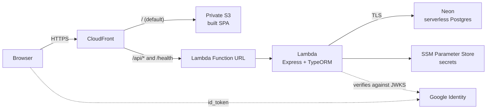

# 🎬 Cinehal

**[Leia em português / Read this in Portuguese](README.md)**

Movie recommendations as a card deck: one movie at a time, and four actions. Your choices feed a tag profile that ranks what comes next.

### Features

- **Recommendation deck**: one movie at a time, with poster, synopsis, review, cast, director, runtime and where to watch. Four actions: *already watched*, *want to watch*, *don't want to watch* and *undo*.
- **Taste profile**: when you mark "already watched", you also say whether you liked it. Each choice adds points to the movie's tags, and that running total ranks the next recommendations.
- **Tag filters**: restrict the deck to chosen genres and themes. When the list runs out, the filters clear themselves.
- **My lists**: everything you mark goes into separate lists by status.
- **Achievements**: milestones based on viewing habits ("Que drama!" after five drama movies, and so on).
- **Initial preferences**: on first access, the user picks tags so the profile doesn't start empty.
- **Tutorial and credits**: an introduction to the actions on the first visit, and the list of people who built the project.

The project started in the **[AGES / PUCRS](https://tools.ages.pucrs.br/cine-clube/cineclube-wiki)** program and was built in a single semester (see the [credits](#-credits)).

## 🧰 Application stack

| Layer | Technology |
|---|---|
| Frontend | React 17 · TypeScript · Material-UI v4 · axios |
| Backend | Node 18 · Express · tsoa (routes + Swagger) · TypeORM 0.2 |
| Tests | Jest, 156 in the backend |

---

## 🔧 What was added later

**Nothing in this section is part of the AGES deliverables.** The product code
described above belongs to the teams; the current infrastructure, deployment and
authentication came later, as work done after the original project.

### Current architecture



CloudFront is the only public address: it serves the SPA from S3 (private bucket, through Origin Access Control) and forwards `/api/*` to the Lambda. Since both live on the same domain there is no CORS, and the session travels in an `HttpOnly` cookie.

**Steady-state cost:** S3 and CloudFront cost cents; Lambda, Function URL, Parameter Store and Neon stay within the free tier.

### Infrastructure stack

| Layer | Technology |
|---|---|
| Database | PostgreSQL 18 on Neon (pooled endpoint) |
| Identity | Google Identity Services → own JWT HS256 session |
| Infra | Lambda · S3 · CloudFront · SSM Parameter Store |

### Monorepo and a single compose file

`backend/` and `frontend/` used to live in separate repositories, each with its own deployment. They became a single repository, with a `docker-compose.yml` at the root pointing to both build contexts.

> 🪤 The CRA build alone goes past 1 GB of heap. On a 1 GB `t3.micro`, building both services in parallel ran out of memory, so the build is sequential and the instance got 4 GB of swap.

### Database: from a container to Neon

Postgres ran in a container next to the application, which tied the data to the machine's lifecycle and ruled out any serverless path, since a function can't run a database beside it.

The application now accepts `DB_URL` with the full connection string; without it, the old path (host/port/user) still works for local development. On the managed path, TLS requires a **verified certificate**: Neon's chains to a public CA, so there is no reason to give up protection against MITM.

### EC2 → Lambda + S3

The EC2 instance ran nginx, the API and the database, and was billed by the hour even when idle. Now:

- Express is wrapped by `serverless-http` in a dedicated handler;
- the built SPA goes to a private S3 bucket;
- CloudFront takes over the routing role nginx used to have.

What the EC2 cost (instance + public IPv4) is gone from the bill.

> 🪤 The handler builds the app **outside** the handler to take advantage of warm containers, and rechecks the connection on every invocation: Neon's pooler closes idle connections, and a container can come back warm with an already dead connection.

### Real authentication

Firebase had been removed at some point, and what replaced it verified nothing: the token was base64 JSON built by the client itself. In practice, sending `Authorization: <someone's-id>` returned that person's data.

Signing on the frontend wouldn't fix it, because the key would be in the bundle. Token issuing moved to the server:

1. Google Identity Services hands the `id_token` to the browser;
2. the backend verifies the signature against Google's JWKS, with `audience` pinned to the client id and `issuer` restricted to the official domains;
3. the backend issues its **own session** (HS256, 8 h) in an `HttpOnly; Secure; SameSite=Lax` cookie.

The session is kept separate from the `id_token` on purpose: the token is a single-use proof of identity, and presenting it on every request would tie the application to its lifecycle.

Two old defects were fixed along the way: axios's `transformResponse` was passed as the POST **body** (the second argument is `data`, not the config), so it never ran; and the `first_login` read never matched the `firstLogin` the backend returns, which is why the preferences screen didn't show up on first access.

### Secrets

They live in **SSM Parameter Store** as `SecureString`, read by the Lambda in a single call at cold start. No connection string or key is kept in versioned code.

Environment variables were ruled out for a specific reason: `lambda:GetFunctionConfiguration` is part of the managed `ReadOnlyAccess` policy, so any read-only access to the account could read the secrets. Reading from Parameter Store requires `ssm:GetParameter` **and** `kms:Decrypt`, granted deliberately.

The values also stay out of the infrastructure state, since they are written in
*write-only* mode.

### Desktop layout

The main screen had been designed for phones, where the 700 px column fills the viewport. On desktop it sat flush to the left: two blocks declared `maxWidth` without `margin: auto`. The width became a single declaration, used by the background, the content and the action bar.

---

## 🚀 Running locally

**Prerequisites:** Node 18 (`react-scripts` 4 doesn't run on recent versions), Docker optional.

```bash
# backend
cd backend
npm install
# create a .env with the variables from the table below
npm run typeorm -- migration:run
npm run db:seed         # not idempotent: run it once
npm run dev             # http://localhost:5000 · docs at /doc

# frontend
cd frontend
npm ci
npm start               # http://localhost:3000
```

### Backend variables

| Variable | Purpose |
|---|---|
| `DB_URL` | Full connection string. When set, the individual variables below are ignored |
| `DB_HOST` `DB_PORT` `DB_DATABASE` `DB_USERNAME` `DB_PASSWORD` | Local Postgres. Leave `DB_SSL` out, since the container doesn't speak TLS |
| `GOOGLE_CLIENT_ID` | OAuth Client ID (*Web application* type). Public |
| `SESSION_SECRET` | Key that signs the sessions |
| `PORT` | Defaults to 5000 |

The frontend needs `REACT_APP_API_URL` (use `/api/v1`, relative) and `REACT_APP_GOOGLE_CLIENT_ID`.

> For login to work, the domain must be listed under **Authorized JavaScript origins** in the Google Cloud console.

### Tests

```bash
cd backend && npx jest        # 156 tests
```

## 📦 Deployment

The infrastructure is provisioned outside this repository.

```bash
# backend: package the function (~33 MB)
cd backend && ./build-lambda.sh

# frontend: build and publish the SPA
cd frontend && npm run build
aws s3 sync build s3://<bucket> --delete
aws cloudfront create-invalidation --distribution-id <id> --paths '/*'
```

The bucket, distribution and public address belong to each environment and are
not versioned.

Migrations are still manual, run against the database: they belong to its lifecycle, not the application's.

---

## 👥 Credits

> The Cinehal group thanks the development team.

One semester, four teams. The names below are the same ones shown on the app's Credits screen.

**AGES 1**
- Alexya Silva Rocha de Oliveira
- Bruno Breyer Garcia
- Henrique Derlam Zwetsche
- Leonardo José Machado Canto

**AGES 2**
- Augusto César Bottega Agostini
- Lucas Dimer Justo

**AGES 3**
- João Pedro Laureano
- Pâmela Mendonça Barreto
- Patrick Mazzuco Flores
- Eduardo Schweitzer Nunes da Silva
- Gabriel Ferreira Kurtz

**AGES 4**
- Chiara Girardi Paskulin
- Alexandre Scheer Bing
- Matheus Lima Ferreira

Academic project from **AGES, Escola Politécnica da PUCRS**.

---

## 📄 Per-module documentation

`backend/README.md` and `frontend/README.md` describe the project as it was delivered by the original teams, including references to Heroku and Firebase that no longer apply. They are kept as a record.
